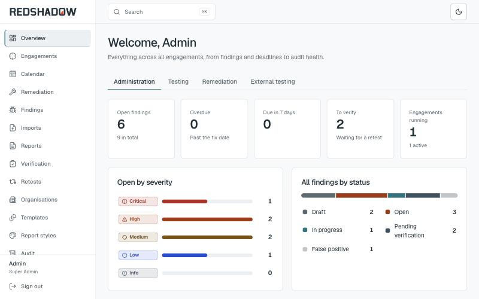

# RedShadow

**Offensive Security, under control.**

RedShadow is a self-hosted penetration-test management platform. It takes an engagement from scoping to a **verified fix**: organisations, assets, engagements, findings, evidence, remediation, retests, scheduling, an append-only audit log and professional PDF and CSV reports. Everyone sees only the work they are meant to see.

Django REST, React and PostgreSQL, run entirely with Docker Compose.



## Features

- **Engagements and scope**: organisations, assets, teams, rules of engagement, status machine and a calendar with drag-to-reschedule.
- **Findings**: CVSS 3.1 and 4.0 scoring, CWE picker, templates, evidence upload with safe file handling, notes and a full timeline.
- **Remediation and verification**: assignment, SLA due dates, remediation queue, retest rounds, verification with required notes, risk acceptance, automatic reopen on expiry.
- **Import and export**: CSV import with column mapping, validation, duplicate detection and safe transactions; CSV export.
- **Reports**: client-facing and internal PDFs with covers, document control, charts and a styled template editor.
- **Access control**: four roles (Super Admin, Pentester, Remediation Owner, External Vendor), custom roles, and object-level scoping enforced on the server.
- **Audit**: hash-chained, append-only log enforced by the database, verified nightly and on demand.
- **Security**: Argon2, TOTP two-step verification, session controls, rate limits, hardened containers.

## Quick start

Requirements: Docker with Compose v2.

```bash
git clone https://github.com/TheShadowConn/RedShadow.git
cd RedShadow
docker compose up --build -d --wait
docker compose logs migrate | grep -A3 "FIRST LOGIN"   # first admin password, shown once
```

Open https://localhost (self-signed certificate) and sign in as `admin@redshadow.local`. You must change the password and enrol two-step verification at the first sign-in. Copy `.env.example` to `.env` to change ports, hosts and limits.

> Never run `docker compose down -v` on a real installation: it deletes the database, uploads and secrets.

## Documentation

- **User and workflow manual (PDF)**: [docs/manual/RedShadow-User-Manual.pdf](docs/manual/RedShadow-User-Manual.pdf). Rebuild with `make manual`.
- Architecture: [docs/ARCHITECTURE.md](docs/ARCHITECTURE.md), [docs/BLUEPRINT.md](docs/BLUEPRINT.md), [docs/adr](docs/adr)
- Operations: [docs/DOCKER_SETUP.md](docs/DOCKER_SETUP.md), [docs/BACKUP_RESTORE.md](docs/BACKUP_RESTORE.md), [docs/RUNBOOKS.md](docs/RUNBOOKS.md)
- Security: [docs/SECURITY.md](docs/SECURITY.md), [docs/ASVS_L2_CHECKLIST.md](docs/ASVS_L2_CHECKLIST.md), [SECURITY.md](SECURITY.md)
- Permissions: [docs/RBAC_PERMISSION_MATRIX.md](docs/RBAC_PERMISSION_MATRIX.md)
- Project status: [PROJECT_STATUS.md](PROJECT_STATUS.md)

## Development

```bash
make test     # backend tests against real Postgres and Redis
make lint     # ruff
make smoke    # stack checks
```

See [CONTRIBUTING.md](CONTRIBUTING.md).

## License and brand

The code is licensed under the **Apache License 2.0** ([LICENSE](LICENSE), [NOTICE](NOTICE)). Third-party components: [THIRD_PARTY_LICENSES.md](THIRD_PARTY_LICENSES.md).

**RedShadow**, **Shadowconn**, their logos and the tagline are reserved brand assets and are **not** covered by the Apache license. Forks must use their own name and logos. See [TRADEMARKS.md](TRADEMARKS.md).

Built by [Shadowconn](https://github.com/TheShadowConn).
