# RedShadow

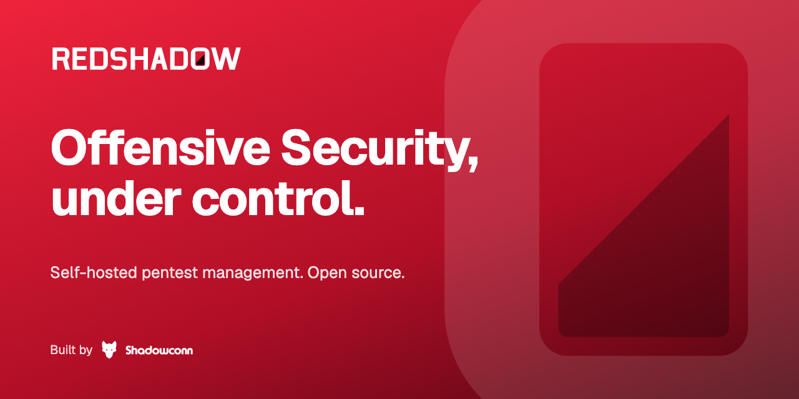

**Offensive Security, under control.**

**Website:** https://theshadowconn.github.io/RedShadow/

[](https://github.com/TheShadowConn/RedShadow/actions/workflows/ci.yml)
[](LICENSE)
[](https://github.com/TheShadowConn/RedShadow/releases)
[](#quick-start)

**RedShadow is an open-source pentest management platform.** Plan engagements, record findings with CVSS and evidence, assign fixes, **retest and verify** them, keep a tamper-evident audit trail, and hand clients a professional PDF report. Self-hosted with one command: `docker compose up`.

It is built for the people in a real penetration test: the **lead who runs the engagement**, the **testers** who find issues, the **remediation owners** who fix them, and **external vendors** who contribute their own findings. Everyone sees only the work they are meant to see.

> Looking for a pentest reporting tool, a findings tracker or a self-hosted alternative to spreadsheets and heavyweight vulnerability managers? RedShadow focuses on the engagement from scoping to a *verified* fix.

## See it

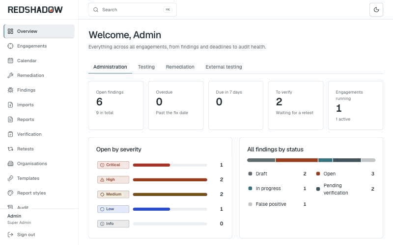

| Dashboard | Finding awaiting verification |
|---|---|
|  | 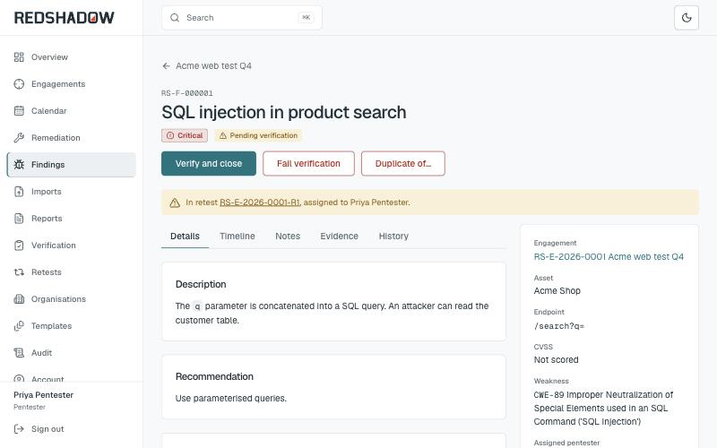 |
| **Retest round** | **Audit log with verified chain** |
| 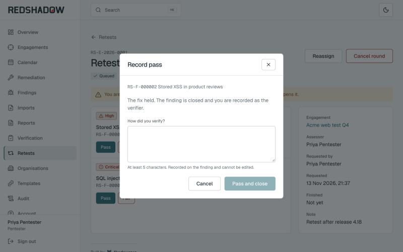 | 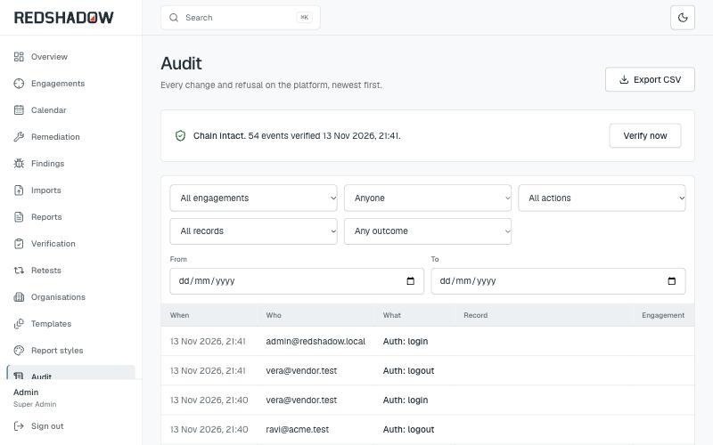 |

<details>
<summary>More screens</summary>

| | |
|---|---|
| 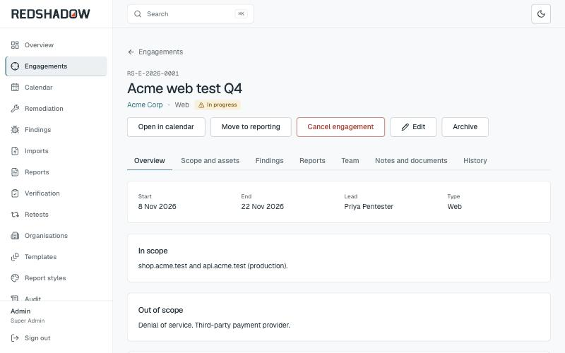 | 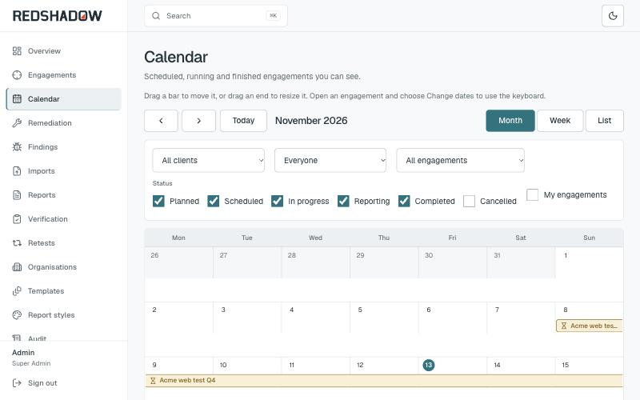 |
| 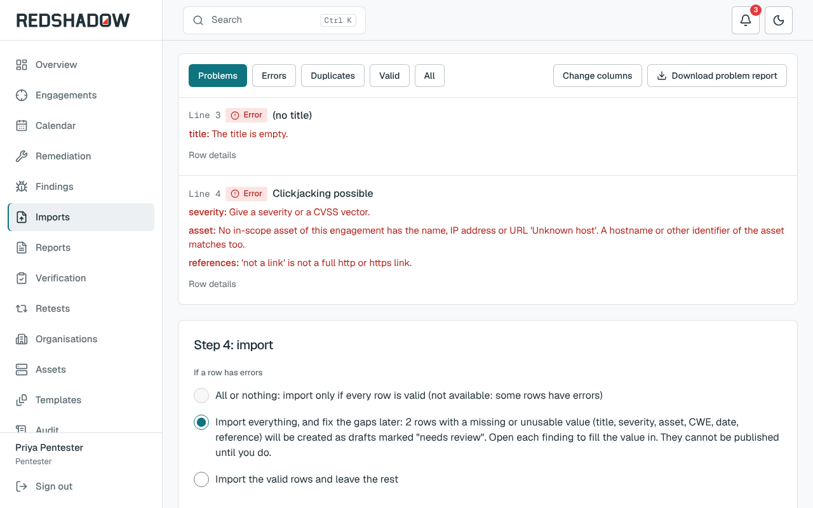 | 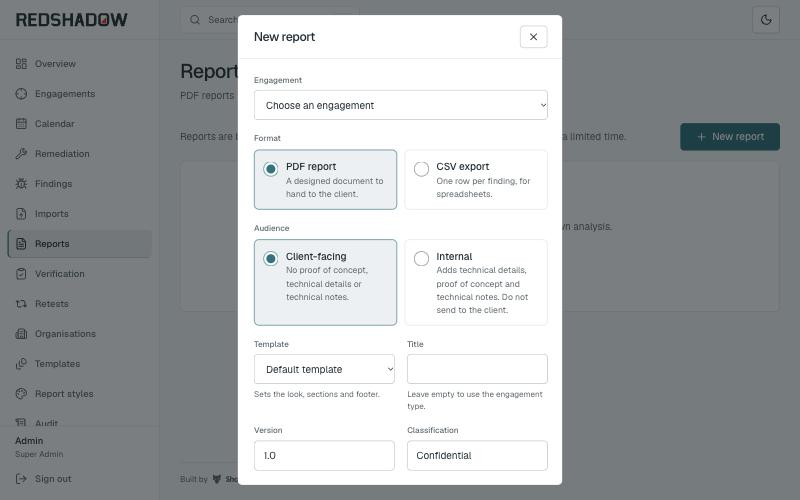 |
| 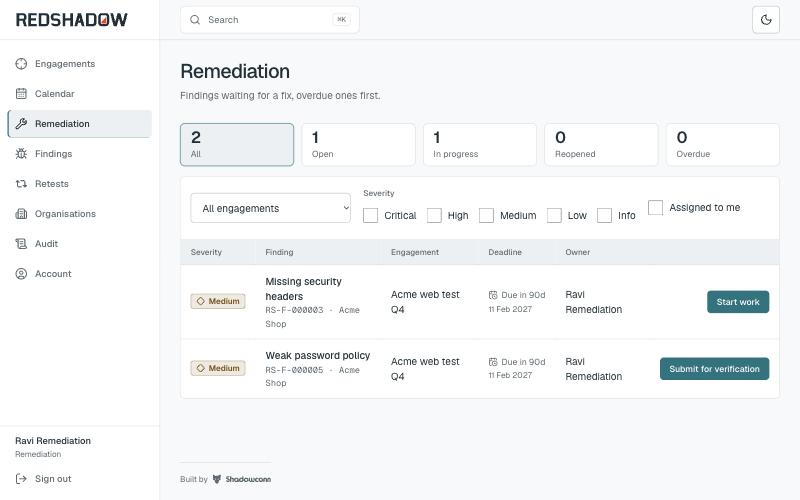 | 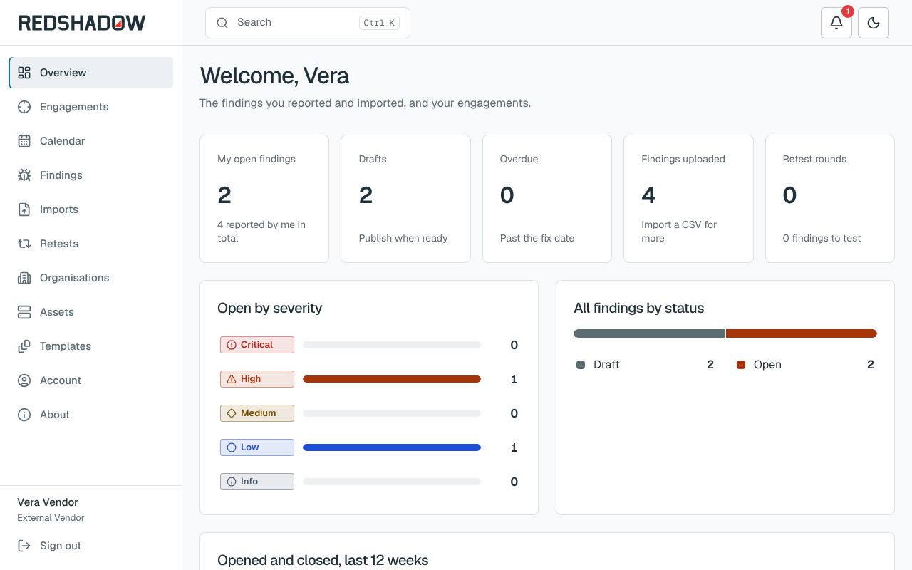 |
| 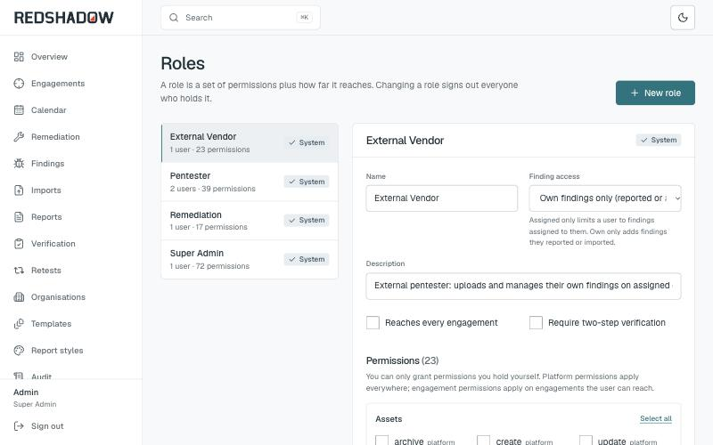 | 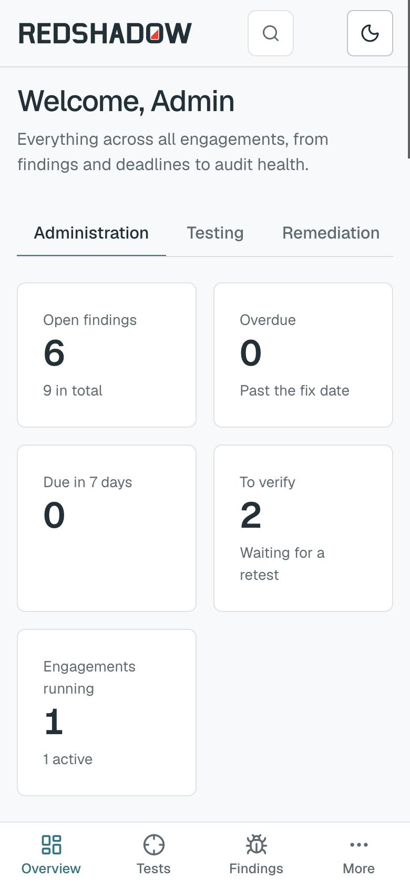 |

</details>

All screens show fictional demo data.

## Why RedShadow

| | Spreadsheets and documents | General vulnerability managers | **RedShadow** |
|---|---|---|---|
| Built around the pentest engagement | Manual | Often product or scan centred | **Yes**: scope, team, rules of engagement, calendar |
| Verified fixes with a written reason | Manual | Varies | **Yes**: retest rounds, pass and fail, reopen |
| Outside testers see only their own work | No | Varies | **Yes**: External Vendor role with own-findings scope |
| Tamper-evident history | No | Varies | **Yes**: hash-chained, database-enforced audit log |
| Client PDF in your style | Copy and paste | Varies | **Yes**: client and internal editions, template editor |
| Runs on your own hardware | Yes | Varies | **Yes**: Docker Compose, no cloud account |

The comparison is general. Check any tool against your own needs.

## Features

- **Engagements and scope**: organisations, assets, teams, rules of engagement, status machine and a calendar with drag-to-reschedule.
- **Findings**: CVSS 3.1 and 4.0 scoring, CWE picker, templates, evidence upload with safe file handling, notes and a full timeline.
- **Remediation and verification**: assignment, SLA due dates, remediation queue, retest rounds, verification with required notes, risk acceptance, automatic reopen on expiry.
- **Import and export**: CSV import with column mapping, validation, duplicate detection and safe transactions; CSV export.
- **Reports**: client-facing and internal PDFs with covers, document control, charts and a styled template editor.
- **Access control**: four roles (Super Admin, Pentester, Remediation Owner, External Vendor), custom roles, and object-level scoping enforced on the server.
- **Audit**: hash-chained, append-only log enforced by the database, verified nightly and on demand.
- **Security**: Argon2, TOTP two-step verification, session controls, rate limits, hardened containers.

## Quick start

Requirements: Docker with Compose v2.

```bash
git clone https://github.com/TheShadowConn/RedShadow.git
cd RedShadow
docker compose up --build -d --wait
docker compose logs migrate | grep -A3 "FIRST LOGIN"   # first admin password, shown once
```

Open https://localhost (self-signed certificate) and sign in as `admin@redshadow.local`. You must change the password and enrol two-step verification at the first sign-in. Copy `.env.example` to `.env` to change ports, hosts and limits.

> Never run `docker compose down -v` on a real installation: it deletes the database, uploads and secrets.

## How it works

Nginx in front, a Django REST API behind it, PostgreSQL for data, Redis and Celery for background jobs, a React app for the interface. Nine containers start in a safe order and only Nginx is exposed. Read [docs/ARCHITECTURE.md](docs/ARCHITECTURE.md) and the [ADRs](docs/adr).

## Documentation

- **User and workflow manual (PDF)**: [docs/manual/RedShadow-User-Manual.pdf](docs/manual/RedShadow-User-Manual.pdf). Rebuild with `make manual`.
- Architecture: [docs/ARCHITECTURE.md](docs/ARCHITECTURE.md), [docs/BLUEPRINT.md](docs/BLUEPRINT.md), [docs/adr](docs/adr)
- Operations: [docs/DOCKER_SETUP.md](docs/DOCKER_SETUP.md), [docs/BACKUP_RESTORE.md](docs/BACKUP_RESTORE.md), [docs/RUNBOOKS.md](docs/RUNBOOKS.md)
- Security: [docs/SECURITY.md](docs/SECURITY.md), [docs/ASVS_L2_CHECKLIST.md](docs/ASVS_L2_CHECKLIST.md), [SECURITY.md](SECURITY.md)
- Permissions: [docs/RBAC_PERMISSION_MATRIX.md](docs/RBAC_PERMISSION_MATRIX.md)
- Roadmap: [docs/ROADMAP.md](docs/ROADMAP.md)

## Status

Version 1.0. The backend has about 780 automated tests, the stack has a 34-check smoke test and a backup and restore drill. An OWASP ZAP scan has not been run yet. Please report vulnerabilities privately: see [SECURITY.md](SECURITY.md).

## Contribute

Ideas, bug reports and pull requests are welcome. Start with [CONTRIBUTING.md](CONTRIBUTING.md) and the issues labelled **good first issue**, or open a discussion. Please star the repo if RedShadow is useful to you, it helps others find it.

```bash
make test     # backend tests against real Postgres and Redis
make lint     # ruff
make smoke    # stack checks
```

## License and brand

The code is licensed under the **Apache License 2.0** ([LICENSE](LICENSE), [NOTICE](NOTICE)). Third-party components: [THIRD_PARTY_LICENSES.md](THIRD_PARTY_LICENSES.md).

**RedShadow**, **Shadowconn**, their logos and the tagline are reserved brand assets and are **not** covered by the Apache license. Forks must use their own name and logos. See [TRADEMARKS.md](TRADEMARKS.md).

Built by [Shadowconn](https://github.com/TheShadowConn).
