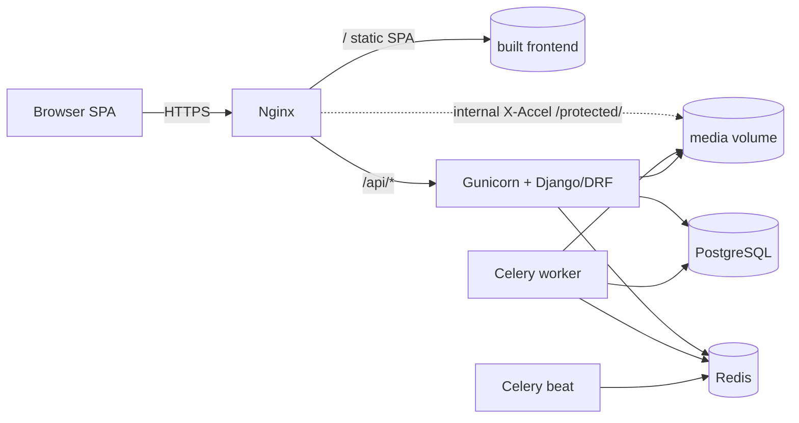
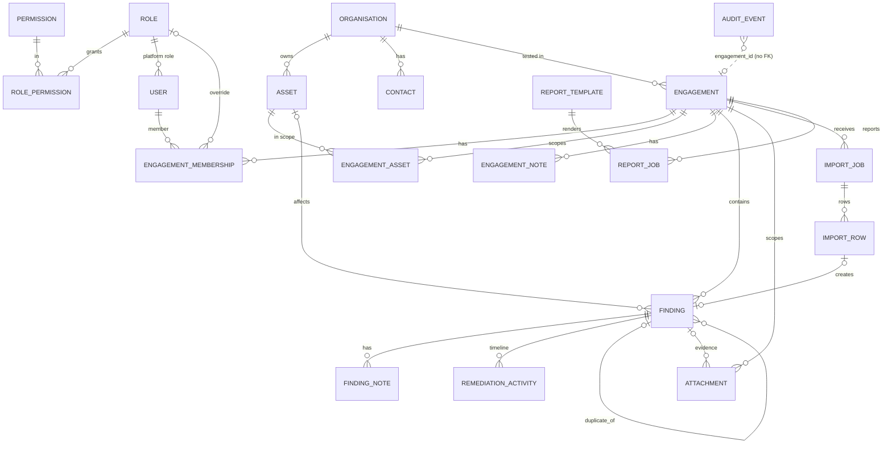

# RedShadow — Architecture Blueprint 

## Context

RedShadow is a new standalone pentest management platform (no existing code; it is not a DefectDojo/DojoX repo and not a git repo yet). It must manage the full pentest lifecycle — organisations, assets, engagements, findings, remediation, scheduling, audit, PDF/CSV reporting — with backend-enforced RBAC plus engagement- and finding-level scoping. Reference apps (DefectDojo at `~/Coding/Defect_Dojo_Community`, OWASP Faction at local checkout) are studied read-only as functional references; nothing is copied. This document is the blueprint for Stage B (Sonnet review) and Stage C (user approval). No code is written until approval; then phases run one at a time with approval between each.

### Reference application findings (verified read-only, evidence paths in repos)

- **Faction** (local checkout): this checkout is **Faction 1.x (Java/Struts2, MongoDB)**; its README points to a separate `OWASP-Faction-2` repo that is **not present locally** — Faction 2 features are not verified and not assumed. Verified in Faction 1: assessments with assessors + remediation contact, statuses Scheduled/In Progress/On Hold/Completed/Past Due (`dao/Status.java`), peer review (`dao/PeerReview.java`), vulnerability templates with CVSS 3.1/4.0 and per-risk-level due days (`dao/DefaultVulnerability.java`, `dao/RiskLevel.java`), first-class retest/verification queue with per-item pass/fail (`dao/Verification.java`, `dao/VerificationItem.java`), DOCX templated reports, calendar with out-of-office, manual audit log calls (~20 files), boolean permission flags, per-field edit locks, random `VID-` ids, loose string-typed file attachments.
- **DefectDojo** (local checkout; sibling `DefectDojo-DojoX` also present — neither will be touched): Product_Type > Product > Engagement > Test > Finding hierarchy; Finding state as ~8 independent booleans (active, verified, false_p, duplicate, out_of_scope, risk_accepted, is_mitigated, under_review); hash_code dedupe with per-parser algorithm; SLA_Configuration days per severity; notes with `private` flag excluded from reports; django-pghistory audit; HTML-widget reports (no server PDF lib found). In this checkout the Reader/Writer/Maintainer/Owner roles are labels only — granular RBAC moved to a commercial plugin.

Lessons adopted: strict FK hierarchy with permissions resolved up the chain; RBAC in core (not flags, not a plugin); one state machine instead of boolean flags; retest as a first-class object (`RetestRound`/`RetestItem`, Phase 5); template library with CVSS 3.1/4.0 + SLA per severity; collision-safe sequential refs; optimistic locking instead of field locks; automatic, transaction-bound audit; private-by-default evidence; notes with visibility flag excluded from client-facing reports. Deferred (not requested): DOCX report export, custom fields, scanner-output parsers, checklists.

---

## 1. Recommended architecture

**Modular monolith**: one Django project, one PostgreSQL database, strict internal module boundaries (Django apps with service-layer APIs; no cross-app model writes except via services).

Why it fits:
- Authorization is the core risk. One process, one DB, one permission resolver = one place to get it right. Microservices would duplicate authz checks and add network trust boundaries with no scaling need (pentest teams are tens to hundreds of users).
- Transactions span modules (finding change + audit event + activity in one DB transaction). Monolith keeps this ACID.
- Single `docker compose up --build -d` deploy; low ops burden.
- Celery handles the only heavy/async work (CSV parse, PDF render, audit chain verification, SLA sweeps).



Request path for every API call: Nginx (TLS, headers, size limits) → Django middleware (session auth, CSRF, request-id, audit context) → DRF view → `authz` resolver (scoped queryset + object permission) → service layer (validation, state machine, transaction) → audit service (same transaction).

---

## 2. Technology stack

| Layer | Choice | Notes |
|---|---|---|
| Backend | Python 3.12, Django 5.2 LTS, DRF | LTS until 2028 |
| API schema | drf-spectacular (OpenAPI 3) | FE types generated via `openapi-typescript` |
| Filtering | django-filter | |
| DB | PostgreSQL 16 | jsonb, triggers, row-level role grants |
| Queue | Celery 5 + Redis 7 | results stored in DB models, not Redis |
| Passwords | argon2-cffi (Django Argon2 hasher) | |
| MFA | pyotp (TOTP) | see open questions |
| CVSS | `cvss` (RedHat lib, LGPL) | server computes score from vector; never trust client score |
| Markdown sanitise | nh3 (server) / react-markdown without raw HTML (client) | |
| File type | `filetype` (pure Python magic bytes) + Pillow (image re-encode, EXIF strip) | |
| PDF | WeasyPrint (HTML/CSS → PDF) | real CSS paged media: headers, footers, page counters, page breaks |
| Charts in PDF | server-built SVG (no matplotlib) | |
| App server | Gunicorn | |
| Frontend | React 19, TypeScript, Vite, Tailwind CSS v4 | |
| Routing / data | React Router, TanStack Query | |
| Tables | TanStack Table (headless) | server-side sort/filter/paginate |
| Forms | react-hook-form + zod | zod schemas mirror OpenAPI |
| Primitives | Radix UI (headless, accessible) | styled with our tokens; no template kit |
| Charts | Recharts | |
| Calendar | FullCalendar standard plugins (daygrid, timegrid, list, interaction — MIT only, no premium) | |
| Icons | lucide-react for UI glyphs | |
| Tests | pytest, pytest-django, factory_boy, coverage; Vitest + Testing Library; Playwright (+ axe-core) | |
| Lint/sec | ruff, mypy (services/authz), eslint, bandit, pip-audit, npm audit | |
| Proxy | Nginx (stable-alpine, unprivileged) | |

Rejected alternatives (only where meaningful):
- JWT in browser storage — rejected; XSS-stealable, hard to revoke. Use HttpOnly session cookies, same origin via Nginx.
- django-guardian per-object perms — rejected; per-row grants explode and are hard to audit. Scoping is derived from engagement membership.
- django-auditlog / pghistory — rejected; need hash-chained, transaction-bound, denormalised events with redaction. Custom audit service (~300 lines) is clearer.
- Separate frontend runtime container — rejected; frontend is a build stage whose output Nginx serves. Fewer moving parts.

---

## 3. Repository structure

```
RedShadow/
  README.md  PROJECT_STATUS.md  .env.example  docker-compose.yml  Makefile
  docs/
    ARCHITECTURE.md DATABASE_SCHEMA.md RBAC_PERMISSION_MATRIX.md SECURITY.md
    API_DOCUMENTATION.md DOCKER_SETUP.md BACKUP_RESTORE.md
    adr/0001-modular-monolith.md ... (see §15)
  backend/
    Dockerfile pyproject.toml
    config/            settings/{base,prod,test}.py urls.py celery.py wsgi.py
    apps/
      core/            base models (UUID, timestamps, soft delete), request-id, errors, pagination, storage
      accounts/        User, auth views, MFA, sessions, password policy, bootstrap command
      rbac/            Permission catalogue, Role, assignments, authz resolver, DRF permission classes
      audit/           AuditEvent, audit service, hash chain, integrity task
      organisations/   Organisation, Contact, Asset
      engagements/     Engagement, membership, notes, documents, calendar endpoints
      findings/        Finding, templates, notes, evidence, lifecycle state machine
      remediation/     remediation activity, verification queue, SLA
      imports/         CSV import jobs, mappings, rows
      reports/         report templates, jobs, PDF/CSV renderers
      dashboards/      read-only aggregate endpoints
      settings_app/    AppSettings singleton, branding, SLA policy
    tests/             cross-module tests (rbac matrix, isolation, escalation)
  frontend/
    Dockerfile package.json vite.config.ts
    src/
      app/             router, providers, auth guard, layout shell
      design/          tokens.css, primitives (Button, Field, Table, Badge, Dialog, Sheet...)
      api/             generated types, query client, fetch wrapper (CSRF)
      features/        auth, users, roles, organisations, engagements, findings, remediation,
                       audit, calendar, imports, reports, dashboards, settings
      lib/             formatting, permissions helpers (UI hints only)
    e2e/               Playwright specs
  nginx/               nginx.conf, security headers, Dockerfile (multi-stage: builds frontend)
  scripts/             backup.sh restore.sh smoke.sh
```

Each Django app: `models.py`, `services.py` (all writes), `selectors.py` (scoped reads), `serializers.py`, `views.py`, `permissions.py`, `tests/`. Views never write models directly.

---

## 4. Database schema (summary; full field types go in DATABASE_SCHEMA.md)

Conventions: UUID v4 primary keys (non-enumerable), `created_at`/`updated_at`, `created_by`; human refs (`RS-E-2026-0012`, `RS-F-000431`) for display only; soft delete (`deleted_at`) on business records; `version` integer for optimistic locking on Engagement and Finding (prevents lost updates; 409 on conflict).

**accounts**
- `User`: id, email (unique, citext), display_name, role_id → Role (platform role, required), is_active, must_change_password, mfa_enabled, mfa_secret (encrypted at rest), session_version (bump = kill all sessions), failed_login_count, locked_until, last_login, last_password_change, deactivated_at. No hard delete: users are deactivated (audit and finding attribution keep working).

**rbac**
- `Permission`: code (`findings.update`), module, action, scope (`platform` | `engagement`), description. Seeded by migration, read-only via API.
- `Role`: id, name (unique), description, is_system (Super Admin/Pentester/Remediation cannot be deleted; Super Admin permissions cannot be edited), all_engagements (bool: role applies to every engagement without membership — Super Admin, or a custom "Auditor"), finding_scope default (`all` | `assigned`).
- `RolePermission`: role_id, permission_id (unique pair).
- `EngagementMembership`: engagement_id, user_id, role_override_id (nullable; a different role on this engagement only), finding_scope override (nullable), added_by, added_at. Unique (engagement, user).

**organisations**
- `Organisation`: name, slug, industry, notes, logo (Attachment), archived_at.
- `Contact`: organisation_id, name, email, phone, title (PII; minimal).
- `Asset`: organisation_id, name, type (web_app, api, host, network_range, mobile_app, cloud_account, source_repo, other), identifier (URL/IP/CIDR/package id), environment (prod/staging/dev), criticality (1–5), tags (array), archived_at.

**engagements**
- `Engagement`: ref, organisation_id, name, type (web, api, mobile, internal_network, external_network, cloud, red_team, social_engineering, code_review, other), status (planned, scheduled, in_progress, reporting, completed, cancelled, archived — `overdue` is derived: end_date < today and status in planned/scheduled/in_progress/reporting), start_date, end_date, scope (markdown), out_of_scope, objectives, methodology, rules_of_engagement, lead_id → User, version, archived_at.
- `EngagementAsset`: engagement_id, asset_id, in_scope (bool), notes. Asset must belong to the engagement's organisation (DB check via service + constraint trigger).
- `EngagementNote`: engagement_id, author_id, body, visibility (`team` = pentest members only | `all` = all members incl. remediation).

**findings**
- `Finding`: ref, engagement_id (immutable after create), asset_id (nullable, must be in engagement scope), title, description, technical_details, poc, recommendation, references (jsonb list of {label,url}), severity (critical, high, medium, low, info), cvss_version, cvss_vector, cvss_score (server-computed), cwe_id (int, validated against seeded CWE list), endpoint, status (see §5.4), reported_by_id, assigned_pentester_id, remediation_owner_id, discovered_at, due_date (from SLA), resolved_at, verified_at, verified_by_id, closed_at, risk_accepted_until, risk_acceptance_reason, dedupe_hash (sha256 of normalised engagement+title+asset+endpoint+cwe), duplicate_of_id, source (manual, import, duplicate, template), import_job_id, version, deleted_at.
  - Indexes: (engagement_id, status), (engagement_id, severity), (remediation_owner_id, status), dedupe_hash, GIN full-text on title+description.
- `FindingTemplate`: library of reusable finding text (title, description, recommendation, cwe, default severity, references). Platform-level.
- `FindingNote`: finding_id, author_id, kind (technical, remediation, verification, retest), visibility (`team` | `all`), body, created_at. Notes are append-only (edit = new revision; original kept in audit).
- `RemediationActivity`: finding_id, actor_id, action (started, fix_deployed, mitigated, submitted_for_verification, verification_passed, verification_failed, reopened, risk_accepted, comment), note, evidence attachment ids, from_status, to_status, created_at. This is the user-facing timeline; the audit log is the tamper-evident record.
- `RetestRound`: engagement_id, number, requested_by_id, assessor_id, status (queued, in_progress, completed, cancelled), requested_at, completed_at, report (Attachment, optional).
- `RetestItem`: round_id, finding_id, result (pending, passed, failed, not_tested), note, evidence attachment ids, tested_by_id, tested_at. Result drives the finding transition (passed → closed, failed → reopened).

**files**
- `Attachment`: id, engagement_id (required — every file is scoped to an engagement; org logos use a platform scope flag), finding_id / note_id / engagement_note_id (nullable owners), kind (evidence, document, logo, report), original_name (sanitised), storage_key (random UUID path), mime (sniffed), size, sha256, uploaded_by_id, deleted_at.

**imports**
- `ImportMapping`: name, owner_id, column_map (jsonb), reusable.
- `ImportJob`: engagement_id, uploaded_by_id, file (Attachment), status (uploaded, parsing, mapped, validating, previewed, importing, completed, failed, cancelled), mapping (jsonb), mode (`all_or_nothing` | `valid_rows_only`), counts (total, valid, invalid, duplicate, imported), error_report (Attachment), started_at, finished_at.
- `ImportRow`: job_id, row_number, raw (jsonb), mapped (jsonb), errors (jsonb list of {field, code, message}), duplicate_of_finding_id, status (valid, invalid, duplicate, skipped, imported), finding_id. Rows retained for history; never silently dropped.

**reports**
- `ReportTemplate`: name, sections (ordered jsonb), branding (logo, colours, fonts from an allow-list), footer text, is_default.
- `ReportJob`: engagement_id (nullable for cross-engagement CSV), format (pdf, csv), template_id, filters (jsonb), status (queued, rendering, done, failed), output (Attachment), sha256, requested_by_id, created_at, expires_at.

**audit**
- `AuditEvent`: id (bigserial), occurred_at, actor_id (no FK constraint), actor_label (email at time of event), actor_ip, user_agent (truncated), request_id, action (e.g. `finding.status_changed`), entity_type, entity_id, entity_label, engagement_id (no FK), engagement_ref, changes (jsonb `{field: [old, new]}`, redacted), metadata (jsonb), outcome (success, denied, failure), prev_hash, hash. No FKs so events survive deletion of anything.

**settings_app**
- `AppSettings` (singleton): org branding, session idle timeout, absolute session lifetime, password policy, MFA enforcement, upload limits, SLA days per severity (critical 7, high 30, medium 90, low 180 defaults), report defaults.

### 4.1 Entity relationship diagram



---

## 5. RBAC design

### 5.1 Model

Effective permissions of user U on engagement E:
1. Platform permissions = `U.role` permissions with scope `platform` (user mgmt, role mgmt, settings, org/asset mgmt, engagement create, global audit, cross-engagement reports, templates).
2. Engagement permissions:
   - if `U.role.all_engagements` → `U.role` engagement-scoped permissions on every engagement;
   - else if membership M(U, E) exists → `(M.role_override or U.role)` engagement-scoped permissions;
   - else → none, and E does not exist for U (404).
3. Finding scope: `M.finding_scope or role.finding_scope`. `assigned` = only findings where `remediation_owner_id = U` (or `assigned_pentester_id = U`).
4. Draft findings are invisible to anyone without `findings.view_draft`.
5. Inactive user, locked user, or `session_version` mismatch → unauthenticated.

Single resolver module `apps/rbac/authz.py`:
- `scope_engagements(user)`, `scope_findings(user, perm)`, `scope_attachments(user)`, `scope_audit(user)` → QuerySets. Every list/detail view starts from these. Out-of-scope objects return **404** (no existence oracle).
- `require(user, perm, obj=None)` → raises PermissionDenied (403) when object is visible but action not allowed.
- Per-request permission cache (dict on request); no cross-request cache, so revocation is instant.
- DRF base viewset `ScopedModelViewSet` forces `get_queryset()` through selectors; a test asserts every registered viewset subclasses it.
- Serializer-level **field permissions**: writable fields depend on perms (e.g. remediation cannot write severity, description, cvss; pentester cannot write remediation_owner unless `findings.assign`). Unknown/forbidden fields in a payload → 400, not silently ignored.

### 5.2 Anti-escalation rules (enforced in `rbac.services`, tested)
- Nobody edits their own role, memberships, or role permissions (even Super Admin; another admin must do it).
- A user can only grant a role whose permission set ⊆ their own effective platform permissions (`roles.assign`).
- Only holders of `roles.manage` create/edit roles; system roles: Super Admin immutable, Pentester/Remediation editable but not deletable.
- Last active Super Admin cannot be deactivated, demoted, or deleted.
- Any role, permission or membership change bumps affected users' `session_version` (forces re-login; simpler and safer than diffing upgrades vs downgrades).
- Engagement membership changes require `engagements.manage_members` on that engagement.
- Mass assignment blocked: `role`, `is_active`, `session_version`, `mfa_*` never writable via profile endpoints.

### 5.3 Permission catalogue and default matrix

Legend: ✅ granted, — denied, (E) engagement-scoped (needs membership unless all_engagements), (A) limited to assigned findings by default finding_scope.

| Module | Permission code | Super Admin | Pentester | Remediation |
|---|---|---|---|---|
| Users | users.view / users.create / users.update / users.deactivate | ✅ | — | — |
| Roles | roles.view / roles.manage / roles.assign | ✅ | — | — |
| Settings | settings.view / settings.manage | ✅ | — | — |
| Organisations | organisations.view (only orgs of visible engagements for non-admins) | ✅ | ✅ (E) | ✅ (E) |
| Organisations | organisations.create / update / archive | ✅ | — | — |
| Assets | assets.view | ✅ | ✅ (E) | ✅ (E) |
| Assets | assets.create / update / archive | ✅ | — | — |
| Engagements | engagements.view | ✅ all | ✅ (E) | ✅ (E) |
| Engagements | engagements.create / delete / archive | ✅ | — | — |
| Engagements | engagements.update (details, scope, dates) | ✅ | — | — |
| Engagements | engagements.update_status | ✅ | ✅ (E) | — |
| Engagements | engagements.manage_members | ✅ | — | — |
| Engagements | engagements.schedule (calendar edit) | ✅ | — | — |
| Engagement notes | engagement_notes.view_team / create | ✅ | ✅ (E) | — |
| Engagement notes | engagement_notes.view_shared | ✅ | ✅ (E) | ✅ (E) |
| Documents | documents.view / upload / delete | ✅ | ✅ (E) view+upload | ✅ (E) view shared |
| Findings | findings.view | ✅ | ✅ (E) | ✅ (E)(A) |
| Findings | findings.view_draft | ✅ | ✅ (E) | — |
| Findings | findings.create / update / duplicate | ✅ | ✅ (E) | — |
| Findings | findings.delete | ✅ | — (grantable) | — |
| Findings | findings.assign (set pentester / remediation owner) | ✅ | ✅ (E) | — |
| Findings | findings.bulk_update | ✅ | ✅ (E) | — |
| Findings | findings.publish (draft → open) | ✅ | ✅ (E) | — |
| Evidence | evidence.view | ✅ | ✅ (E) | ✅ (E)(A) |
| Evidence | evidence.upload / delete_own | ✅ | ✅ (E) | ✅ (E)(A) remediation evidence |
| Notes | finding_notes.technical | ✅ | ✅ (E) | — |
| Notes | finding_notes.remediation | ✅ | ✅ (E) | ✅ (E)(A) |
| Remediation | remediation.update_status (open ↔ in_progress) | ✅ | ✅ (E) | ✅ (E)(A) |
| Remediation | remediation.submit_verification | ✅ | ✅ (E) | ✅ (E)(A) |
| Remediation | findings.verify (pass/fail retest) | ✅ | ✅ (E) | — |
| Remediation | findings.close | ✅ | ✅ (E) | — (grantable: "close when authorised") |
| Remediation | findings.reopen | ✅ | ✅ (E) | — |
| Remediation | findings.risk_accept | ✅ | — | — |
| Templates | templates.view / templates.manage | ✅ | ✅ view | — |
| Imports | imports.create / imports.view | ✅ | ✅ (E) | — |
| Exports | exports.csv | ✅ | ✅ (E) | ✅ (E)(A) |
| Reports | reports.generate_pdf | ✅ | ✅ (E) | — (grantable) |
| Reports | reports.view | ✅ | ✅ (E) | ✅ (E) if granted |
| Reports | reports.manage_templates | ✅ | — | — |
| Audit | audit.view_all | ✅ | — | — |
| Audit | audit.view_engagement (history of visible engagements/findings) | ✅ | ✅ (E) | ✅ (E)(A) own findings only |
| Audit | audit.verify_integrity / audit.export | ✅ | — | — |
| Calendar | calendar.view (only visible engagements) | ✅ | ✅ (E) | ✅ (E) |
| Dashboards | dashboards.admin / dashboards.pentester / dashboards.remediation | ✅ admin | ✅ own | ✅ own |

Custom roles: admin UI shows the catalogue grouped by module as a read/create/update/delete/import/export/close grid; toggles `all_engagements` and default `finding_scope`. Engagement-level scope = membership (+ optional role override per engagement).

### 5.4 Finding lifecycle (validated state machine in `findings/lifecycle.py`)

States: `draft`, `open`, `in_progress`, `pending_verification`, `reopened`, `closed`, `risk_accepted`, `false_positive`, `duplicate`.
Added beyond the request, with reasons: `draft` (pentester QA before client sees it), `risk_accepted` (business accepts risk, requires reason + expiry; beat task reopens on expiry), `false_positive`, `duplicate` (import/dedupe).

| From | To | Required permission | Rule |
|---|---|---|---|
| draft | open | findings.publish | required fields complete; sets due_date from SLA |
| open / reopened | in_progress | remediation.update_status | |
| in_progress | open | remediation.update_status | |
| open / in_progress / reopened | pending_verification | remediation.submit_verification | remediation note required |
| pending_verification | closed | findings.verify or findings.close | verification note required; sets verified_by/at |
| pending_verification | reopened | findings.verify | failure note required |
| closed | reopened | findings.reopen | reason required |
| open / in_progress / reopened | closed | findings.close | direct close (authorised), note required |
| open / in_progress / reopened | risk_accepted | findings.risk_accept | reason + expiry ≤ max days setting |
| risk_accepted | reopened | findings.reopen or beat expiry | |
| draft / open | false_positive | findings.update | reason required |
| any non-closed | duplicate | findings.update | duplicate_of required, same engagement |

Transitions run in `transaction.atomic()` with `select_for_update` on the finding, write `RemediationActivity` + `AuditEvent`, and check `version` (409 on stale).

---

## 6. Security and threat model (STRIDE-style, summary; full in SECURITY.md)

| Area | Threats | Controls |
|---|---|---|
| Authentication | credential stuffing, brute force, user enumeration | Argon2id; per-account lockout (5 fails / 15 min) + per-IP throttle in Redis; identical error/timing for unknown user; optional/enforced TOTP MFA; password policy (min 12, breach-list check offline top-100k); forced change on bootstrap |
| Session | theft, fixation, CSRF | HttpOnly + Secure + SameSite=Lax session cookie; rotate on login; idle timeout 30 min + absolute 12 h; `session_version` revocation; CSRF token header for all unsafe methods; logout invalidates server-side |
| Authorization / RBAC | IDOR, escalation, mass assignment | scoped querysets everywhere, 404 on out-of-scope, field-level serializer perms, anti-escalation rules §5.2, automated matrix tests |
| Engagement isolation | cross-engagement leak via search, exports, dashboards, attachments, audit, autocomplete | every aggregate/search/export uses the same selectors; attachment download re-checks scope; FK targets in payloads (asset_id, duplicate_of_id, user ids) validated to be in same engagement/org; isolation test suite with two orgs |
| API | over-fetching, abuse, verbose errors | DRF throttles, pagination caps (max 200), no stack traces in prod, uniform error envelope, OpenAPI only for authenticated admins in prod |
| File uploads | malware, polyglots, stored XSS, path traversal, zip bombs | size limit (default 25 MB, nginx + Django), magic-byte allow-list (png, jpg, gif, webp, pdf, txt, log, csv, json, xml, zip, pcap, docx/xlsx), SVG/HTML refused, random storage keys outside web root, downloads only via authorised endpoint + Nginx `internal` X-Accel-Redirect, `Content-Disposition: attachment` (images inline only after re-encode), `X-Content-Type-Options: nosniff`, separate CSP sandbox; optional ClamAV compose profile |
| CSV import | CSV injection, DoS, encoding tricks | size/row caps (25 MB / 50k rows), stdlib csv with field size limit, UTF-8/UTF-8-SIG only, parsed in worker, per-row validation, never eval; exports neutralise cells starting `= + - @ \t \r` |
| PDF generation | SSRF, local file read, HTML injection | WeasyPrint custom `url_fetcher` allowing only our media storage keys + bundled fonts; user markdown sanitised with nh3 to a tag allow-list; no remote URLs; render in worker with timeout and memory limit |
| Audit integrity | tampering, deletion, gaps | app DB role has INSERT/SELECT only on audit table; Postgres trigger rejects UPDATE/DELETE/TRUNCATE; SHA-256 hash chain (prev_hash) under advisory lock; nightly beat verification task alerts on break; optional periodic export of chain head to off-host location |
| Secrets | leakage in repo/logs/images | `.env` (git-ignored) + Docker secrets for DB password and SECRET_KEY files; `.env.example` with placeholders; logs redact `password`, `token`, `secret`, `cookie`, `authorization`; MFA secrets encrypted with a key derived from a dedicated env key |
| Database | over-privileged app, exposure | two roles: `redshadow_owner` (migrations) and `redshadow_app` (DML, no DDL, restricted audit grants); Postgres not published to host; scram-sha-256 auth |
| Docker | container breakout, exposed ports | only Nginx publishes ports; internal network for db/redis; non-root users; `read_only` root fs where possible; `cap_drop: [ALL]`; `no-new-privileges`; pinned image digests; Redis with password, protected mode, no published port |
| Web / XSS | stored XSS in markdown fields | React escaping; react-markdown without raw HTML; strict CSP (`default-src 'self'`, no inline scripts); HSTS when TLS; `frame-ancestors 'none'`; Referrer-Policy |

OWASP references: ASVS 4.0.3 L2 as acceptance baseline, Top 10 2021, API Security Top 10 2023, Cheat Sheets (Authorization, Session Management, File Upload, CSV Injection, Logging).

---

## 7. API structure

REST, JSON, `/api/v1/`, session auth + CSRF. UUIDs in paths. Error envelope `{ "error": { "code", "message", "fields": {} , "request_id" } }`. Cursor-free page pagination (`?page=&page_size=`, max 200). Filtering via query params; sorting `?ordering=-severity,discovered_at`; full-text `?search=`.

```
/api/v1/auth/   login  logout  me  password/change  mfa/setup  mfa/verify  csrf
/api/v1/users/  [GET POST]  /{id} [GET PATCH]  /{id}/deactivate  /{id}/reactivate  /{id}/reset-password  /{id}/sessions/revoke
/api/v1/roles/  [GET POST]  /{id} [GET PATCH DELETE]   /api/v1/permissions/ [GET]
/api/v1/organisations/ ...  /{id}/assets/  /{id}/contacts/
/api/v1/assets/{id}
/api/v1/engagements/ [GET POST]  /{id} [GET PATCH]  /{id}/archive  /{id}/status
   /{id}/members/ [GET POST]  /{id}/members/{user_id} [PATCH DELETE]
   /{id}/assets/  /{id}/notes/  /{id}/documents/  /{id}/history/
   /{id}/findings/ [GET POST]  /{id}/imports/ [POST]  /{id}/reports/ [POST]  /{id}/export.csv
/api/v1/findings/ [GET]  (cross-engagement, scoped)  /{id} [GET PATCH DELETE]
   /{id}/transition  /{id}/duplicate  /{id}/notes/  /{id}/evidence/  /{id}/activity/  /{id}/history/
/api/v1/findings/bulk  (bulk update/transition/assign; per-item authz; partial results reported)
/api/v1/finding-templates/
/api/v1/attachments/{id}/download   (authz then X-Accel-Redirect)
/api/v1/imports/{id}  /{id}/mapping  /{id}/rows?status=  /{id}/commit  /{id}/cancel  /{id}/error-report
/api/v1/import-mappings/
/api/v1/reports/{id}  /{id}/download   /api/v1/report-templates/
/api/v1/calendar/events?start=&end=&pentester=&client=&status=&engagement=
/api/v1/audit/events?actor=&engagement=&entity_type=&entity_id=&action=&from=&to=   /api/v1/audit/verify
/api/v1/dashboards/admin  /pentester  /remediation
/api/v1/settings/
/api/v1/health/live  /health/ready   (no auth; no data)
/api/v1/schema/  (admin only in prod)
```

---

## 8. UI/UX architecture

Applies `design-taste-frontend` system rules; app-specific decisions recorded in ADR-0009.

Design system (from the skill, adapted):
- Neutral interface 90–95%; one accent for primary action, focus ring, links. Accent and type pairing dealt via the skill's `start.mjs deal --page software` + `start.mjs css`, re-dealt if violet. Never violet/lavender (affects severity palette: info = slate-blue, not purple).
- Severity is data colour, not decoration: critical (deep red), high (orange-red), medium (amber), low (blue), info (slate) — each with text label + icon shape, never colour alone; contrast checked.
- Radius `sharp` (4/6/8) — the skill's choice for developer/security tools. One button pair (primary filled, secondary), 44px controls, 16px body text, 13px minimum labels (no tracked caps), ink contrast ≥7:1, muted ≥4.5:1. Spacing scale 4…128.
- Motion tokens from skill: hover in 140 ms, out 200 ms, press 90 ms, panel 200 ms; card lift 2px only on linked cards; focus ring 2px accent; everything rests under `prefers-reduced-motion`. No scroll-triggered animation.
- Light theme default plus dark theme (tech kind allows dark), chosen by user toggle, persisted.
- Not applied (marketing-only): one section per screen, hero deals, photographs, `consistency.mjs` page-section checks. The skill's `check.mjs`/`shoot.mjs` may still be used for multi-width screenshots of app screens where they run without page-type metadata; otherwise Playwright does responsive screenshots.

Shell and navigation:
- Desktop ≥1280: fixed left sidebar (Dashboard, Engagements, Findings, Remediation, Calendar, Reports, Admin) + top bar (global search ⌘K, user menu). Admin items rendered only if permitted (UX only; backend enforces).
- Tablet 768–1279: collapsible icon rail; detail pages switch from split to stacked.
- Mobile <768: bottom tab bar (4 role-relevant tabs + More sheet), full-screen menu, tables become card lists with the 3 key fields (severity, title, status), sticky action bar on finding detail (Add note / Change status), filters in a bottom sheet. Remediation workflow designed mobile-first (most likely mobile use).

Key screens: Login/MFA; role dashboards (admin, pentester, remediation — different data, same components); Engagement list (table + saved filters) and detail (tabs: Overview, Scope & assets, Findings, Team, Notes & documents, History); Finding list (dense table, bulk select, column chooser); Finding detail (two-pane: content left, metadata/status/timeline right); Finding editor (markdown with preview, CVSS vector builder computing score live, CWE autocomplete, evidence drop-zone); Remediation queue (my findings, grouped by status, SLA due badges); Verification queue (pentester); Calendar (month/week/list); Import wizard (upload → map → validate/preview → confirm → summary); Reports (generate, history, download); Audit explorer (filters, diff viewer); Admin (users, roles permission grid, settings, templates).

States: every data view has skeleton loading, empty state with the one next action, error state with retry + request id, permission-denied state, optimistic toasts for success, inline field errors from API `fields`.

Accessibility: WCAG 2.2 AA; Radix focus management; keyboard shortcuts documented; axe in Playwright.

---

## 9. Background processing

Celery queues: `default` (notifications-light work), `imports` (parse/validate/commit), `reports` (PDF render, concurrency 2, time limit 120 s), `maintenance`. Beat schedule: audit chain verify (nightly), SLA overdue flags (hourly), risk-acceptance expiry (hourly), expired report/import file cleanup (daily), session cleanup (daily). Tasks are idempotent, receive IDs only, re-check permissions of the requesting user at execution time, and write status to DB models polled by the UI.

## 10. File and evidence storage

Local filesystem volume `media` mounted at `/data/media` in backend and worker (Nginx mounts read-only for X-Accel). Layout `/data/media/<yyyy>/<mm>/<uuid>` (no user-controlled names). Storage behind a small `core.storage` interface so S3/MinIO can be added later without touching callers (not built now). SHA-256 stored for integrity; images re-encoded (EXIF stripped); soft-deleted files purged by maintenance task after retention period (setting).

## 11. Reporting architecture

- PDF: Django template (HTML) + print CSS → WeasyPrint in `reports` worker. Sections: cover (branding, logo, classification label), document control, executive summary, engagement info, scope, methodology, findings summary table, severity distribution (SVG bar/donut built server-side), per-finding pages (severity badge, CVSS, CWE, asset/endpoint, description, PoC, evidence images, recommendation, remediation status), appendix. CSS paged media: `@page` margins, running header/footer, `counter(page)`/`counter(pages)`, `break-inside: avoid` on finding blocks, table header repetition. Bundled open-licence fonts (e.g. Inter / IBM Plex — chosen from the dealt pairing if licence allows embedding).
- CSV: streaming response for small exports; Celery for large; same selectors as UI; formula-injection neutralisation; filters for severity, status, remediation owner, date ranges.
- Every generation writes `report.generated` audit event with filters and output hash.

## 12. Docker architecture

Services (`docker-compose.yml`):

| Service | Image | Ports | Depends on | Healthcheck |
|---|---|---|---|---|
| nginx | multi-stage: node build of `frontend/` → nginx-unprivileged | 80/443 → host (only published service) | backend healthy | `wget /healthz` |
| backend | `backend/Dockerfile` (python slim, non-root) gunicorn | none | migrate completed, db healthy, redis healthy | `/api/v1/health/ready` |
| migrate | same image, `manage.py migrate && bootstrap_admin` one-shot | none | db healthy | exit code (`service_completed_successfully`) |
| worker | same image, celery worker | none | db, redis healthy, migrate completed | `celery inspect ping` |
| beat | same image, celery beat (DB-stored schedule state file on volume) | none | worker | process check |
| db | postgres:16-alpine | none | — | `pg_isready` |
| redis | redis:7-alpine, requirepass | none | — | `redis-cli ping` |

- Volumes: `pgdata` (Postgres), `media` (uploads, reports, import files), `beat` (schedule). Named volumes; never removed by normal commands; README warns `docker compose down -v` destroys data.
- Networks: `edge` (nginx only), `internal` (`internal: true`: backend, worker, beat, db, redis).
- `restart: unless-stopped` on long-running services (survives host restart when Docker starts on boot).
- Config: `.env` (from `.env.example`) + secret files in `./secrets/` (git-ignored) for `SECRET_KEY`, DB passwords, MFA key; generated by `scripts/init-secrets.sh`.
- Bootstrap admin: `bootstrap_admin` runs only when no Super Admin exists; email from `BOOTSTRAP_ADMIN_EMAIL`; password either from secret file or randomly generated and printed once to `migrate` logs; `must_change_password=True`; idempotent; audited.
- TLS: `TLS_MODE=off|selfsigned|provided`; provided certs mounted read-only.
- Upgrades: rebuild images, `migrate` service applies migrations before backend starts; migrations must be backward-compatible within one release.
- Backup: `scripts/backup.sh` → `pg_dump -Fc` via `docker compose exec db` + `tar` of media volume, timestamped, with SHA-256 manifest. Restore: `scripts/restore.sh` (stop app services, restore DB into empty DB, restore media, run migrate, verify audit chain). Documented in BACKUP_RESTORE.md and tested in Phase 1 and Phase 12.

## 13. Testing strategy

- Unit (pytest): lifecycle transitions table-driven, CVSS parsing, dedupe hash, CSV validators, audit hash chain, redaction, permission resolver.
- API integration (DRF APIClient + factories): every endpoint happy path + validation errors.
- **RBAC matrix test**: generated from a declarative table (endpoint × method × role × in-scope/out-of-scope → expected status 2xx/403/404). A meta-test fails if a new URL route is not in the table.
- Cross-engagement isolation: two organisations, two engagements, users in each; assert no leakage through list, detail, search, export, dashboard counts, calendar, audit, attachment download, autocomplete, bulk endpoints, FK injection in payloads.
- Privilege escalation: self role edit, granting superset role, removing last admin, mass assignment fields, membership self-add, role_override abuse, stale session after demotion.
- Authentication: lockout, throttle, enumeration timing parity (tolerance), session rotation, idle/absolute expiry, CSRF required, MFA.
- Finding lifecycle and remediation: every allowed and disallowed transition per role; optimistic locking conflicts; SLA due dates.
- CSV import: malformed files, encodings, BOM, huge field, formula cells, duplicates within file and vs DB, all-or-nothing rollback, valid-only mode, row error report.
- PDF: render golden engagement, assert page count > 0, text extraction contains sections, SSRF attempt via markdown image URL blocked, render time budget.
- Audit integrity: UPDATE/DELETE rejected by DB, chain verify detects tamper (done with owner role in test), events written in same transaction (rollback leaves no event).
- Frontend: Vitest for components/hooks; Playwright e2e per role at 390, 768, 1024, 1440 widths with axe checks.
- Docker: `scripts/smoke.sh` — compose up, health ready, login, create engagement, restart containers, data persists; rebuild, data persists.
- Coverage target: 90% on `rbac`, `audit`, `findings/lifecycle`, `imports`; 80% overall.

## 14. Implementation roadmap (revised sequence)

Changes from the proposed order, with reasons:
- Audit **core** (model, service, DB immutability, hash chain) moves into Phase 2: auth and RBAC events must be audited from the first login. Phase 6 keeps audit UI, explorer, verification and export.
- Frontend scaffold, design tokens and app shell start in Phase 1–2, not Phase 11; every phase delivers responsive UI for its features. Phase 11 becomes a design/mobile/accessibility refinement pass.
- Attachment/storage infrastructure lands in Phase 3 (engagement documents) and is reused by evidence, imports and reports.
- CSV **export** ships with Phase 8 imports (shared column definitions); PDF in Phase 9.

Complexity: S ≈ 1–2 days, M ≈ 3–5, L ≈ 1–2 weeks, XL ≈ 2+ weeks (single engineer equivalent).

**Phase 0 — Architecture and documentation (this blueprint) — S**
- Objective: approved blueprint. After approval, first step of Phase 1 writes docs/ADRs from it and `git init` (with approval).
- Acceptance: user approval of revised blueprint after Sonnet review.

**Phase 1 — Docker infrastructure, database, skeletons — M**
- Features: compose stack (§12), Django project + `core` app, settings split, Postgres two-role setup (init script), Redis, Celery worker/beat wired with a ping task, health endpoints, Nginx with security headers and SPA serving, Vite+React+Tailwind skeleton with design tokens file and placeholder shell, secret init script, backup/restore scripts, Makefile, CI-ready test commands, docs set created.
- DB: `core` base abstractions only (no business tables).
- API: `/health/live`, `/health/ready`.
- Security: no published db/redis ports, non-root, secrets files, headers.
- Acceptance: `docker compose up --build -d` from clean clone → all services healthy; `/` serves SPA; ready endpoint checks DB + Redis; restart + rebuild keep a test row; backup then restore into fresh volume works.
- Tests: pytest health tests, smoke.sh, backup/restore drill.

**Phase 2 — Authentication, users, RBAC, audit core, app shell — XL**
- Features: User model, login/logout/me, CSRF, session policy, lockout/throttle, password policy, forced change, TOTP MFA with hashed recovery codes and per-role enforcement, bootstrap admin; Permission catalogue + Role + RolePermission + (EngagementMembership lands in Phase 3 with Engagement; Phase 2 delivers platform scope plus resolver interfaces whose engagement hooks are tested against a test-only model); authz resolver, ScopedModelViewSet, field permissions; anti-escalation services; audit service with hash chain, DB grants + trigger, redaction, request metadata middleware; frontend login, MFA, shell (sidebar/rail/bottom tabs), users admin, roles admin with permission grid.
- API: auth/*, users/*, roles/*, permissions/.
- Acceptance: three default roles seeded; custom role created and assigned; self-escalation attempts all fail; every auth/user/role event in audit with valid chain; app DB role cannot UPDATE/DELETE audit rows.
- Tests: auth suite, escalation suite, audit integrity suite, RBAC matrix scaffold.

**Phase 3 — Organisations, assets, engagements, attachments — L**
- Features: Organisation/Contact/Asset CRUD + archive; Engagement CRUD, status, archive, scope/objectives/methodology, types, dates, EngagementAsset scoping, memberships (pentesters, remediation users, role override, finding_scope), notes with visibility, documents via Attachment + secure download; engagement history tab (from audit).
- Acceptance: pentester sees only assigned engagements everywhere; isolation suite passes for orgs/engagements/attachments; upload validation rejects disallowed types.
- Tests: CRUD, isolation, upload security, membership management authz.

**Phase 4 — Findings and evidence — XL**
- Features: Finding CRUD, draft/publish, CVSS 3.1/4.0 vector parsing and score, CWE list, references, assignment, duplication, soft delete (authorised), search/filter/sort, bulk operations with per-item authz, templates library, evidence upload/gallery, technical notes, optimistic locking, full history view.
- Acceptance: remediation users cannot see drafts or non-assigned findings (when scope=assigned); forbidden field writes rejected; history shows every change.
- Tests: lifecycle subset, field permissions, bulk authz, search isolation, CVSS.

**Phase 5 — Remediation workflow and SLA — L**
- Features: full state machine (§5.4), remediation queue UI, retest rounds + verification queue for pentesters, remediation notes/activities with evidence, risk acceptance with expiry, SLA due dates and overdue flags (beat tasks), mobile-first remediation screens.
- Acceptance: every transition allowed/denied per matrix; activities and audit recorded; overdue computed.
- Tests: transition table tests per role, beat tasks, concurrency (two users transition simultaneously).

**Phase 6 — Audit explorer and integrity — M**
- Features: audit explorer (filters: actor, engagement, entity, action, date; diff viewer), role-restricted history views, integrity verification endpoint + nightly task + admin alert banner, audit CSV export (admin).
- Acceptance: non-admins see only events tied to visible entities; tamper simulation detected.

**Phase 7 — Calendar and scheduling — M**
- Features: month/week/list views, status colours (scheduled, in progress, completed, overdue), filters (pentester, engagement, status, date, client), admin drag/resize to reschedule (calls engagement update with `engagements.schedule`), conflict hint when a pentester is double-booked.
- Acceptance: calendar data passes isolation tests; non-schedulers cannot move events (API 403).

**Phase 8 — CSV import and export — L**
- Features: wizard (§8), saved mappings, worker parsing, row validation, duplicate detection (in-file and vs engagement via dedupe_hash), preview with paginated row errors, all-or-nothing or valid-only commit in one transaction (chunked inserts within it), import summary, downloadable error report, import history; CSV exports with filters.
- Acceptance: 50k-row file imports in worker without timeout; invalid rows always visible; rollback leaves zero findings on failure.

**Phase 9 — PDF reporting engine — L**
- Features: report templates + branding settings, WeasyPrint renderer (§11), SVG charts, evidence embedding, async generation, report history, download, audit.
- Acceptance: golden report renders with correct page numbers, headers/footers, no split finding headers; SSRF test blocked; permission checks enforced.

**Phase 10 — Dashboards and analytics — M**
- Features: admin, pentester, remediation dashboards (metrics listed in brief), Recharts severity/status charts, upcoming assessments, recent activity — all from scoped selectors with DB aggregation.
- Acceptance: counts match scoped list endpoints for each role (test asserts equality).

**Phase 11 — Mobile UI and design refinement — M**
- Features: audit every screen at 390/768/1024/1440, mobile card lists, bottom sheets, touch targets, dark theme polish, accessibility fixes (axe zero serious), empty/error state review, performance budgets (bundle splitting per route).

**Phase 12 — Security testing and deployment hardening — L**
- Features: OWASP ASVS L2 checklist pass, ZAP baseline scan against local stack, bandit/pip-audit/npm audit clean, container hardening review, rate-limit tuning, backup/restore drill, upgrade drill (N → N+1 with data), final SECURITY.md and runbooks.

Every phase: plan shown → approval → implement → tests → report changed files + results → update PROJECT_STATUS.md → present next phase → wait.

## 15. Documentation plan

- `README.md`: what it is, quick start, default ports, first login.
- `docs/ARCHITECTURE.md`, `DATABASE_SCHEMA.md`, `RBAC_PERMISSION_MATRIX.md` (generated table checked against seeded catalogue by a test), `SECURITY.md` (threat model, controls, reporting), `API_DOCUMENTATION.md` (conventions + link to OpenAPI), `DOCKER_SETUP.md`, `BACKUP_RESTORE.md`, `PROJECT_STATUS.md` (root; phase table: done/in progress/pending, known gaps).
- ADRs (`docs/adr/`): 0001 modular monolith; 0002 session cookies over JWT; 0003 RBAC model (platform role + engagement membership + finding scope); 0004 custom hash-chained audit; 0005 UUID keys + soft delete; 0006 WeasyPrint for PDF; 0007 local volume storage behind interface + X-Accel downloads; 0008 frontend served by Nginx build stage; 0009 design-taste-frontend adaptation for an app; 0010 finding state machine.

## 16. Risks and trade-offs

- Hash-chained audit serialises audit inserts (advisory lock) — fine at this scale; documented throughput ceiling. Hash chain proves tampering only if chain head is anchored off-host; recommend periodic export.
- WeasyPrint system dependencies (Pango, fonts) enlarge backend image (~150 MB). Alternative headless Chromium is larger and riskier. Accept.
- Engagement-only scoping (no organisation-level membership) means remediation users must be added per engagement; bulk-add UI mitigates. Org-level membership can be added later without schema break (deferred, ADR-0003).
- FullCalendar standard is MIT but large; lazy-loaded on calendar route only.
- `cvss` library is LGPL — used as an unmodified dependency, acceptable; noted in licences.
- Session auth ties API to browser; machine clients (CI scanners) would need API tokens later — deferred, designed as hashed personal tokens with scoped permissions.
- Local single-host deployment: no HA. Backups mandatory; documented.

## 17. Token and infrastructure optimisation

- Docs and ADRs are the source of truth; each phase reads only PROJECT_STATUS.md + the relevant doc section, not the whole tree.
- Generated OpenAPI → TS types: no hand-duplicated API types.
- Declarative RBAC table drives tests and the matrix doc: one source, no drift.
- One backend image for backend/migrate/worker/beat; multi-stage builds with layer caching (deps before source); `.dockerignore`.
- Celery for heavy work only; no separate scheduler service beyond beat; Redis without persistence (state in Postgres).
- Targeted test runs per phase (`pytest apps/<module>`) before full suite.
- Avoid dependencies beyond §2; each new dependency needs a one-line justification in the phase report.

## 18. Verification of this blueprint (Stage B checklist for Sonnet)

Sonnet review should check: RBAC resolver covers every read path (search, exports, dashboards, calendar, audit, attachments, bulk); escalation rules complete; lifecycle table vs permissions consistent; audit grants/trigger realistic with Django migrations (owner vs app role); Docker persistence and migrate ordering; secrets handling; anything over-engineered for a small-team product (candidates: MFA in v1, hash chain, role override, ClamAV profile).

## Decisions confirmed by user (2026-11-12)
- Deployment: **internal network** (LAN/VPN). `TLS_MODE=selfsigned` default with option for provided certs; HSTS only when TLS on; MFA available and enforceable per role by admin (Super Admin role enforced by default).
- Remediation users: **both internal staff and client staff**. Default note visibility `team` (hidden from remediation); explicit per-note sharing; drafts and technical/internal notes never shown to remediation; client-facing wording on remediation screens; remediation scoped per engagement.
- MFA: **TOTP in Phase 2** (pyotp), recovery codes (hashed), admin reset audited.
- Faction 2: not verified (not local); blueprint relies on verified Faction 1.x and DefectDojo features only.
